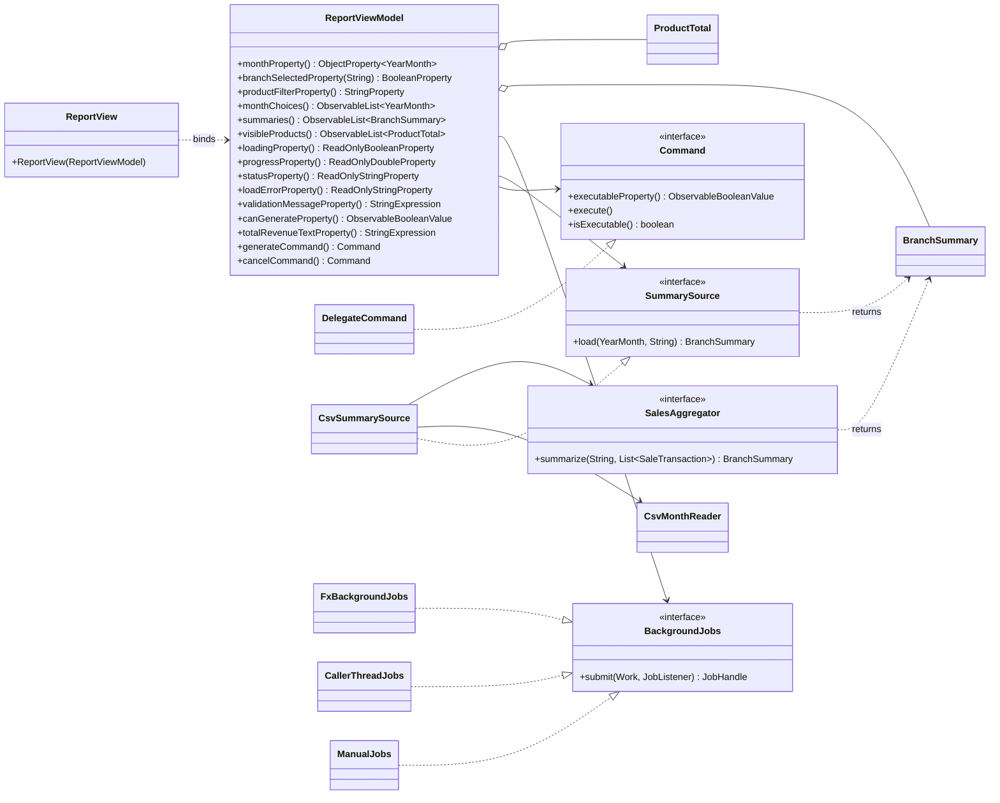

# Lab 03 — ViewModel design

Base: Lab-02 (commit `65cf4db`). Lab-02 has an MVC controller (`ReportController` + `ReportView`) and an MVP presenter (`ReportPresenter` + `FxReportScreen`). The inventory below covers the logic of both, since the ViewModel replaces them.

## 1. Controller inventory

| #  | Code (Lab-02)                                                                                | Concern                                                             | New owner                                                                         |
| -- | -------------------------------------------------------------------------------------------- | ------------------------------------------------------------------- | --------------------------------------------------------------------------------- |
| 1  | `monthField.getText()` passed to `monthEntered(text)`                                    | Input state: selected month                                         | ViewModel (`month`)                                                             |
| 2  | Month `TextField` default `"2026-09"` (hard-coded)                                       | Initial value / choices from the clock                              | ViewModel (`monthChoices`, last 12 months)                                      |
| 3  | `branchBox.getValue()` passed to `branchChosen(text)` (single ComboBox: ALL/PNH/REP/BTB) | Input state: branch selection                                       | ViewModel (`branchSelected(b)`, one tick box per branch)                        |
| 4  | `InputRules.month`: blank / unparsable month → `Invalid`                                | Validation rule                                                     | ViewModel (`monthError`); keep `InputRules` as pure helper                    |
| 5  | `InputRules.month`: `month.isAfter(YearMonth.now(clock))` → "… is in the future"       | Validation rule (message becomes "Month 2026-10 is in the future.") | ViewModel (`monthError`)                                                        |
| 6  | `InputRules.branch`: unknown branch code                                                   | Validation rule (replaced by "Select at least one branch.")         | ViewModel (`branchError`)                                                       |
| 7  | `errors.showError(message)` / `screen.showError(...)` for validation                     | Presentation of validation message                                  | ViewModel (`validationMessage`); View binds a label                             |
| 8  | `model.load(dataDir, month)` reads the whole month, all branches, synchronously            | Data access                                                         | Model, behind `SummarySource` (one branch per call)                             |
| 9  | `catch (NoSuchFileException / IOException)` → `showError("No sales data …")`           | Load error handling, keeps old data                                 | ViewModel (`loadError`)                                                         |
| 10 | `model.summary()` + `aggregator.summarize(branch, rows)`                                 | Business computation                                                | Model (`SalesAggregator`, called inside the `SummarySource` implementation)   |
| 11 | `table.getItems().setAll(rows)` with per-transaction `RowItem`                           | Output state                                                        | ViewModel (`summaries`: one row per branch); View only renders                  |
| 12 | `showCategoryRevenue(s.revenueByCategory())` → bar chart                                  | Output state                                                        | ViewModel keeps per-branch data in `summaries`; View draws chart                |
| 13 | `ReportPresenter.money()` / status format string                                           | Formatting                                                          | ViewModel (`totalRevenueText`, `status`); `USD 12,345.60`                   |
| 14 | `model.visibleTransactions()` filter by branch                                             | Presentation filter                                                 | ViewModel (`selectedBranches()`, `products`/`visibleProducts`)              |
| 15 | *Nothing* — Lab-02 loads on the UI thread and freezes                                     | Threading                                                           | ViewModel through the `BackgroundJobs` port (`loading`, `progress`, Cancel) |
| 16 | Enter key / combo `setOnAction` wiring                                                     | Event forwarding                                                    | View (calls `generateCommand().execute()`)                                      |
| 17 | Layout, columns, `ReadOnlyStringWrapper` cell factories, chart, styling                    | Rendering                                                           | View                                                                              |

Points where Lab-02 had no logic and the ViewModel adds some: Generate/Cancel enablement (`canGenerate`, `cancelCommand.executable`), progress, product filter, chain total.

## 2. ViewModel members

| Group    | Member                | Type                                                         | View may write?    |
| -------- | --------------------- | ------------------------------------------------------------ | ------------------ |
| Input    | `month`             | `ObjectProperty<YearMonth>`                                | Yes (two-way)      |
| Input    | `branchSelected(b)` | `BooleanProperty` per branch                               | Yes (two-way)      |
| Input    | `productFilter`     | `StringProperty`                                           | Yes (two-way)      |
| Output   | `monthChoices`      | unmodifiable `ObservableList<YearMonth>`                   | No                 |
| Output   | `summaries`         | unmodifiable `ObservableList<BranchSummary>`               | No                 |
| Output   | `visibleProducts`   | `FilteredList<ProductTotal>` exposed as `ObservableList` | No                 |
| Output   | `loading`           | `ReadOnlyBooleanProperty`                                  | No                 |
| Output   | `progress`          | `ReadOnlyDoubleProperty`                                   | No                 |
| Output   | `status`            | `ReadOnlyStringProperty`                                   | No                 |
| Output   | `loadError`         | `ReadOnlyStringProperty`                                   | No                 |
| Computed | `monthError`        | `StringExpression`                                         | No                 |
| Computed | `branchError`       | `StringExpression`                                         | No                 |
| Computed | `validationMessage` | `StringExpression`                                         | No                 |
| Computed | `canGenerate`       | `ObservableBooleanValue`                                   | No                 |
| Computed | `totalRevenue`      | `ObservableObjectValue<BigDecimal>`                        | No                 |
| Computed | `totalRevenueText`  | `StringExpression`                                         | No                 |
| Command  | `generate`          | `Command`                                                  | `execute()` only |
| Command  | `cancel`            | `Command`                                                  | `execute()` only |

## 3. Class diagram

`CallerThreadJobs` (Task 2) and `ManualJobs` (tests) are the test doubles; `FxBackgroundJobs` (Task 4) is the production implementation. `CsvSummarySource` is new glue: it adapts Lab-02's `CsvMonthReader` + `DefaultSalesAggregator` to the one-branch-per-call `SummarySource` port (see below).

## 4. Adapting the Lab-02 model

`SalesModel.load` reads every branch file of the month and mixes the rows; the ViewModel needs one branch at a time so that progress and Cancel work per branch. Plan: add `CsvMonthReader.readBranch(Path, YearMonth, String)` (reads only `<BRANCH>-*.csv`) and implement `SummarySource` as `(m, b) -> aggregator.summarize(b, reader.readBranch(dataDir, m, b).rows())`. `SalesModel` and the Lab-02 views stay untouched for the Task 5 baseline.
